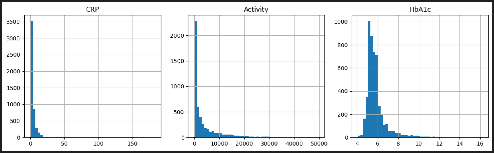
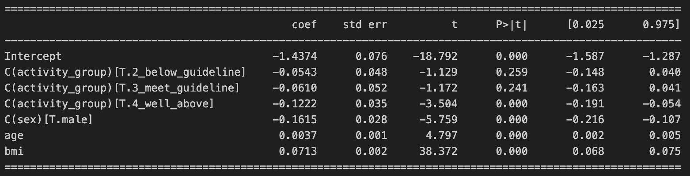
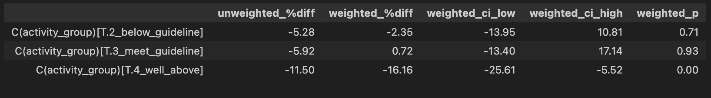

Question:

Do more active adults have lower inflammation and better blood sugar control?
    
To what degree does a person's standard level of activity impact their CRP level, as well as their hemoglobin a1c? These measurements were specifically chosen as they are reliable indicators of physical health, cardiovascular and metabolic in particular.

Data:

The data used was the CDC's NHANES 2017-18 data. The specific files chosen were BMX_J, HSCRP_J, GHB_J, DEMO_J, and PAQ_J. The variables that were used from each file are detailed further below in the 'variables' section.

Physical activity was determined using self reported data that covered if a person does vigorous activity at work, if they do vigorous activity recreationally, if they do moderate activity at work, if they do moderate activity recreationally, and if they walk or bike. Then, for each of those questions, those who said yes were asked how many days a week they do that specific activity, as well as how many minutes a day on a day they do that activity.

Demographic data covered respondant sequence number, age, gender, respondant MEC exam weight, primary sampling unit, and stratum. NHANES uses a multistage design in which areas (PSUs) are sampled within strata; I clustered standard errors on PSU within stratum to approximate this.

Body measures data covered solely BMI, body mass index.

High-sensitivity C-reactive protein data and glycohemoglobin (hemoglobin a1c) data were also used.

Methods:

Before downloading the data, a repository was created, initialized with git, and a virtual environment was generated within. After downloading the data, I performed a series of SQL queries to join the datasets into one table –– prepped for analysis –– then analysis using pandas, numpy, and statsmodels was performed to answer the research question.

SQL:

A table titled analysis was created by selecting sequence number, age, crp, hba1c, bmi, exam weight, stratum, and primary sampling unit. Cases were also created to define male and female by their 1 and 2 codes, defining 4 age groups, and weekly minutes for each kind of activity by filtering through gate questions (do you do this activity and how many days a week) then multiplying by activity minutes. These were all joined together by sequencing number into one table, and only rows with non-null crp and hba1c values were accepted. The analysis table was then altered and updated to contain minutes of met activity per week, which used the WHO/GPAQ guidance of 8 met for vigorous and 4 met for moderate and walking/biking. As I noticed that some activity scores were extremely high, I added another column which marked whether a score was implausible which flagged any row person that had at least 16 hours worth of activity per day for the week. Self reporting can be confusing or mistaken, and this flagged 17 rows which hopefully truncated any obvious mistakes.

Analysis:

The dataframe was selected as rows from analysis which had a non-null activity score, a non-null bmi, and a plausible activity score. Then histograms of crp, activity, and hba1c were created to see if any variables needed a log transform. The histograms showed CRP and the activity score were strongly right-skewed, and HbA1c was mildly right-skewed. 

CRP was log-transformed. Activity was converted to four groups (none, below guideline, meets guideline, well above guideline), because 25% of people scored exactly zero and a log cannot spread out identical values. The cutoffs created were: none = 0 MET-min/week, below = under 600, meets = 600 to 1,199, well above = 1,200 or more. The score of 600 corresponds to the 150 minutes of moderate activity per week guideline (150 x 4 METs). The 1,200 cutoff was my own choice. 
    
Exploratory GROUP BY queries by activity and age group showed the raw decline in CRP and HbA1c weakened within age groups, which suggested age was confounding the raw pattern. Some cells were small, so I moved to regression. Three nested OLS models were fit for each outcome: unadjusted, adjusted for age and sex, and adjusted for age, sex, and BMI. The no-activity group was the reference. CRP coefficients are on the log scale and were converted to percent differences with exp(coef) - 1. HbA1c was modeled on its raw scale, so its coefficients are differences in HbA1c percentage points. BMI can be both a confounder and a middle step between activity and CRP, so results are reported with and without it. 

    
Average BMI barely differed across activity groups (30.3, 30.0, 29.2, 29.5), so BMI explains little of the activity-CRP link. A weighted version of the fully adjusted models used the NHANES exam weight (WTMEC2YR, stored as weight), with standard errors clustered on stratum-by-PSU. This approximates the survey design and is not a full design-based analysis.

Exclusions:

5,142 adults (18 and older) had both CRP and HbA1c measurements. 44 (0.9%) were excluded for an unknown (“don’t know”) or invalid activity response, leaving 5,098. Don’t-know counts were tiny (1 to 13 per variable) and no one refused. This is a complete-case approach. 17 were excluded for implausible activity, defined as more than 6,720 total reported minutes per week (16 hours a day for 7 days), leaving 5,081. 82 were excluded for missing BMI, leaving a final sample of 4099. People who answered “no” to an activity gate question were kept and counted as zero minutes, not treated as missing.

Key Results:

CRP, well above guideline vs none: about 22% lower unadjusted, 15% lower after age and sex, and 11.5% lower after adding BMI (95% CI about -17% to -5%). Weighted: about 16% lower (95% CI about -26% to -6%). CRP, below and meets guideline: not distinguishable from no activity. Adjusted estimates were about -5% and -6% with intervals crossing zero, and weighted p-values were 0.71 and 0.93.

HbA1c, well above guideline vs none: about 0.12 points lower after full adjustment (p = 0.001). Weighted: about 0.17 points lower (95% CI about -0.25 to -0.08). HbA1c, middle groups: about 0 in the unweighted model, then about -0.11 and -0.10 once weighted (p = 0.15 and 0.05). This is suggestive but not conclusive. 
    
Other CRP predictors: each BMI point was associated with about 7% higher CRP, males had about 15% lower CRP than females, and each year of age was associated with about 0.4% higher CRP. Unweighted and weighted results agreed on the main finding, so it does not appear to come from the survey’s oversampling.

Limitations:

Observational data, so these are associations, not causal effects. Activity is self-reported and may be overstated or overlapping across categories. The 16-hour screen is a rough check, and the highest scores still sit on a smooth tail, so some implausible values likely remain.Reverse causation is possible, especially for HbA1c, since people with diabetes may exercise less or change their activity after diagnosis. BMI is a crude measure and may be a confounder and a pathway at once, so the adjusted and unadjusted estimates answer different questions.

Activity groups are coarse, and the cutoffs, apart from the 600 guideline, were my own choices. Results are for adults with complete data on the variables used. Dropping people with unknown activity or missing BMI may bias results slightly. The weighted analysis approximates the survey design and ignores strata in the variance calculation. With about 30 clusters, clustered standard errors can be too small, and a full survey-design analysis would be more rigorous. Multiple comparisons: about a dozen coefficients were tested, so borderline p-values (like 0.05) should not be over-read.
    
Sedentary time (PAD680) was available but not used in the models.

Variables:

(A list of which variables are selected, what their codes are, why they were chosen in particular, and their missing or rejected values)

File - BMX_J

Variable Name:BMXBMI
SAS Label:Body Mass Index (kg/m**2)
English Text:Body Mass Index (kg/m**2)
Target:Both males and females 2 YEARS - 150 YEARS
Range: 12.3 to 86.2
Count: 8005
Missing(.): 699
Total: 8704

File - HSCRP_J

Variable Name:LBXHSCRP
SAS Label:HS C-Reactive Protein (mg/L)
English Text:High-Sensitivity C-Reactive Protein (hs-CRP) (mg/L)
Target:Both males and females 1 YEARS - 150 YEARS
Range: 0.11 to 182.82
Count: 7250
Missing(.): 1116
Total: 8366

File - GHB_J

Variable Name:LBXGH
SAS Label:Glycohemoglobin (%)
English Text:Glycohemoglobin (%)
Target:Both males and females 12 YEARS - 150 YEARS
Range: 3.8 to 16.2
Count: 6045
Missing(.): 356
Total: 6401

File - DEMO_J

Variable Name:SEQN
SAS Label:Respondent sequence number
English Text:Respondent sequence number.
Target:Both males and females 0 YEARS - 150 YEARS

Variable Name:RIAGENDR
SAS Label:Gender
English Text:Gender of the participant.
Target:Both males and females 0 YEARS - 150 YEARS
Male(1): 4557
Female(2): 4697
Total: 9254

Variable Name:RIDAGEYR
SAS Label:Age in years at screening
English Text:Age in years of the participant at the time of screening. Individuals 80 and over are topcoded at 80 years of age.
Target:Both males and females 0 YEARS - 150 YEARS
0-79: 8827
80: 427
Total: 9254

Variable Name:WTMEC2YR
SAS Label:Full sample 2 year MEC exam weight
English Text:Full sample 2 year MEC exam weight.
Target:Both males and females 0 YEARS - 150 YEARS
Range: 2566.1838545 to 419762.83649
Measured: 8704
Not examined(0): 550
Total: 9254

Variable Name:SDMVPSU
SAS Label:Masked variance pseudo-PSU
English Text:Masked variance unit pseudo-PSU variable for variance estimation
Target:Both males and females 0 YEARS - 150 YEARS
1 to 2: 9254

Variable Name:SDMVSTRA
SAS Label:Masked variance pseudo-stratum
English Text:Masked variance unit pseudo-stratum variable for variance estimation
Target:Both males and females 0 YEARS - 150 YEARS
134 to 148: 9254

File - PAQ_J

Variable Name:PAD615
SAS Label:Minutes vigorous-intensity work
English Text:How much time {do you/does SP} spend doing vigorous-intensity activities at work on a typical day?
English Instructions:PROBE IF NEEDED: Think about a typical day when {you do/he does/she does} vigorous-intensity activities during {your/his/her} work. PROBE IF NEEDED: Vigorous-intensity activity causes large increases in breathing or heart rate and is done for at least 10 minutes continuously. INTERVIEWER: REMEMBER, WE ARE ONLY ASKING ABOUT WORK AND CHORES. (SP interview version) SOFT EDIT: >4 HOURS. SOFT EDIT WORDING: INTERVIEWER, YOU HAVE RECORDED THAT THE SP SPENDS MORE THAN 4 HOURS DOING VIGOROUS-INTENSITY ACTIVITIES AT WORK ON A TYPICAL DAY. PLEASE CONFIRM WITH SP THAT OVER 4 HOURS IS CORRECT. HARD EDIT: >24 HOURS. HARD EDIT: <10 MINUTES. ENTER NUMBER OF MINUTES OR HOURS (MEC interview version) SOFT EDIT: >4 hours. ERROR MESSAGE: INTERVIEWER, YOU HAVE RECORDED THAT THE SP SPENDS MORE THAN 4 HOURS DOING VIGOROUS-INTENSITY ACTIVITIES AT WORK ON A TYPICAL DAY. PLEASE CONFIRM WITH SP THAT OVER 4 HOURS IS CORRECT. HARD EDIT: LESS THAN 10 MINUTES OR 24 HOURS OR MORE. ERROR MESSAGE: THE TIME SHOULD BE 10 MINUTES OR MORE, BUT LESS THAN 24 HOURS. ENTER NUMBER (OF MINUTES OR HOURS)
Target:Both males and females 18 YEARS - 150 YEARS
Count: 1375
Missing(.): 4475
Don't know(9999): 6
Total: 5856

Variable Name:PAD630
SAS Label:Minutes moderate-intensity work
English Text:How much time {do you/does SP} spend doing moderate-intensity activities at work on a typical day?
English Instructions:PROBE IF NEEDED: Think about a typical day when {you do/he does/she does} moderate-intensity activities during your work. PROBE IF NEEDED: Moderate-intensity activity causes small increases in breathing or heart rate and is done for at least 10 minutes continuously. INTERVIEWER: REMEMBER, WE ARE ONLY ASKING ABOUT WORK AND CHORES. (SP interview version) SOFT EDIT: >4 HOURS. SOFT EDIT WORDING: INTERVIEWER, YOU HAVE RECORDED THAT THE SP SPENDS MORE THAN 4 HOURS DOING MODERATE-INTENSITY ACTIVITIES AT WORK ON A TYPICAL DAY. PLEASE CONFIRM WITH SP THAT OVER 4 HOURS IS CORRECT. HARD EDIT: >24 HOURS. HARD EDIT: <10 MINUTES. ENTER NUMBER OF MINUTES OR HOURS (MEC interview version) SOFT EDIT: >4 hours. ERROR MESSAGE: INTERVIEWER, YOU HAVE RECORDED THAT THE SP SPENDS MORE THAN 4 HOURS DOING MODERATE-INTENSITY ACTIVITIES AT WORK ON A TYPICAL DAY. PLEASE CONFIRM WITH SP THAT OVER 4 HOURS IS CORRECT. HARD EDIT: LESS THAN 10 MINUTES OR 24 HOURS OR MORE. ERROR MESSAGE: THE TIME SHOULD BE 10 MINUTES OR MORE, BUT LESS THAN 24 HOURS. ENTER NUMBER (OF MINUTES OR HOURS)
Target:Both males and females 18 YEARS - 150 YEARS
Count: 2413
Missing(.): 3430
Don't know(9999): 13
Total: 5856

Variable Name:PAD645
SAS Label:Minutes walk/bicycle for transportation
English Text:How much time {do you/does SP} spend walking or bicycling for travel on a typical day?
English Instructions:PROBE IF NEEDED: Think about a typical day when {you walk or bicycle/SP walks or bicycles} walk or bicycle for travel. (SP interview version) SOFT EDIT: >4 HOURS. SOFT EDIT WORDING: INTERVIEWER, YOU HAVE RECORDED THAT THE SP SPENDS MORE THAN 4 HOURS WALKING OR BICYCLING TO GET TO AND FROM PLACES ON A TYPICAL DAY. PLEASE CONFIRM WITH SP THAT OVER 4 HOURS IS CORRECT. HARD EDIT: >24 HOURS. HARD EDIT: <10 MINUTES. ENTER NUMBER OF MINUTES OR HOURS (MEC interview version) SOFT EDIT: >4 hours. ERROR MESSAGE: INTERVIEWER, YOU HAVE RECORDED THAT THE SP SPENDS MORE THAN 4 HOURS WALKING OR BICYCLING TO GET TO AND FROM PLACES ON A TYPICAL DAY. PLEASE CONFIRM WITH SP THAT OVER 4 HOURS IS CORRECT. HARD EDIT: LESS THAN 10 MINUTES OR 24 HOURS OR MORE. ERROR MESSAGE: THE TIME SHOULD BE 10 MINUTES OR MORE, BUT LESS THAN 24 HOURS. ENTER NUMBER (OF MINUTES OR HOURS)Target:Both males and females 18 YEARS - 150 YEARS
Count: 1426
Missing(.): 4426
Don't know(9999): 4
Total: 5856

Variable Name:PAD660
SAS Label:Minutes vigorous recreational activities
English Text:How much time {do you/does SP} spend doing vigorous-intensity sports, fitness or recreational activities on a typical day?
English Instructions:PROBE IF NEEDED: Think about a typical day when {you do/SP does} vigorous-intensity sports, fitness or recreational activities. (SP interview version) SOFT EDIT: >4 HOURS. SOFT EDIT WORDING: INTERVIEWER, YOU HAVE RECORDED THAT THE SP SPENDS MORE THAN 4 HOURS DOING VIGOROUS-INTENSITY RECREATIONAL ACTIVITIES ON A TYPICAL DAY. PLEASE CONFIRM WITH SP THAT OVER 4 HOURS IS CORRECT. HARD EDIT: >24 HOURS. HARD EDIT: <10 MINUTES. ENTER NUMBER OF MINUTES OR HOURS (MEC interview version) SOFT EDIT: >4 hours. ERROR MESSAGE: INTERVIEWER, YOU HAVE RECORDED THAT THE SP SPENDS MORE THAN 4 HOURS DOING VIGOROUS-INTENSITY RECREATIONAL ACTIVITIES ON A TYPICAL DAY. PLEASE CONFIRM WITH SP THAT OVER 4 HOURS IS CORRECT.HARD EDIT: LESS THAN 10 MINUTES OR 24 HOURS OR MORE. ERROR MESSAGE: THE TIME SHOULD BE 10 MINUTES OR MORE, BUT LESS THAN 24 HOURS. ENTER NUMBER (OF MINUTES OR HOURS)
Target:Both males and females 18 YEARS - 150 YEARS
Count: 1430 
Missing(.): 4425
Don't know(9999): 1
Total: 5856

Variable Name:PAD675
SAS Label:Minutes moderate recreational activities
English Text:How much time {do you/does SP} spend doing moderate-intensity sports, fitness or recreational activities on a typical day?
English Instructions:PROBE IF NEEDED: Think about a typical day when {you do/SP does} moderate-intensity sports, fitness or recreational activities. PROBE IF NEEDED: Moderate-intensity sports, fitness or recreational activities cause small increases in breathing or heart rate and is done for at least 10 minutes continuously. (SP interview version) SOFT EDIT: >4 HOURS. SOFT EDIT WORDING: INTERVIEWER, YOU HAVE RECORDED THAT THE SP SPENDS MORE THAN 4 HOURS DOING MODERATE-INTENSITY RECREATIONAL ACTIVITIES ON A TYPICAL DAY. PLEASE CONFIRM WITH SP THAT OVER 4 HOURS IS CORRECT. HARD EDIT: >24 HOURS. HARD EDIT: <10 MINUTES. ENTER NUMBER OF MINUTES OR HOURS (MEC interview version) SOFT EDIT: >4 hours. ERROR MESSAGE: INTERVIEWER, YOU HAVE RECORDED THAT THE SP SPENDS MORE THAN 4 HOURS DOING MODERATE-INTENSITY RECREATIONAL ACTIVITIES ON A TYPICAL DAY. PLEASE CONFIRM WITH SP THAT OVER 4 HOURS IS CORRECT. HARD EDIT: LESS THAN 10 MINUTES OR 24 HOURS OR MORE. ERROR MESSAGE: THE TIME SHOULD BE 10 MINUTES OR MORE, BUT LESS THAN 24 HOURS. ENTER NUMBER (OF MINUTES OR HOURS)
Target:Both males and females 18 YEARS - 150 YEARS
Count: 2300
Missing(.): 3555
Don't know(9999): 1
Total: 5856